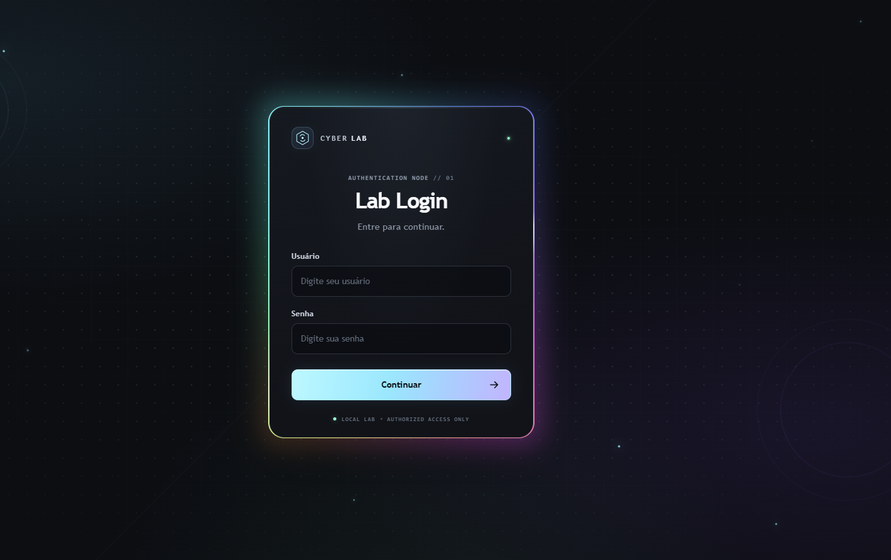
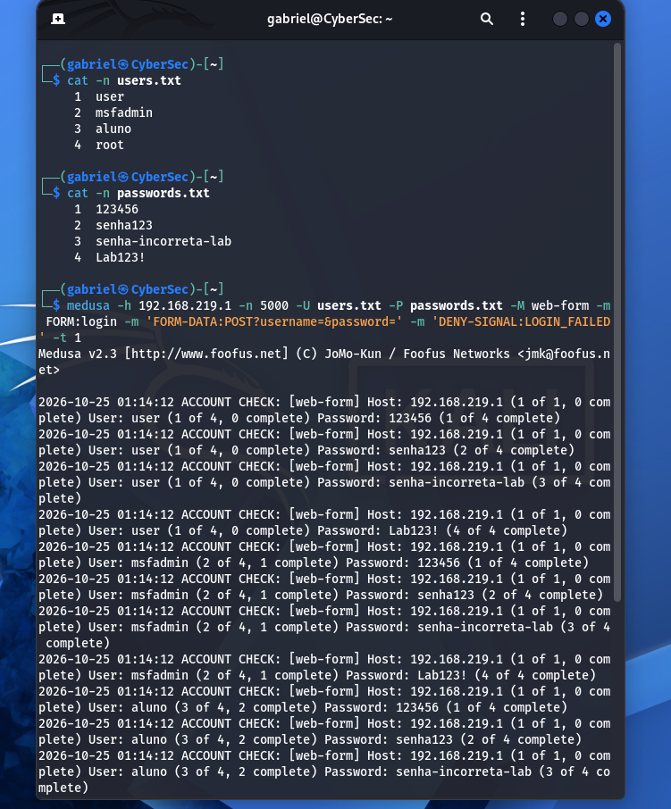
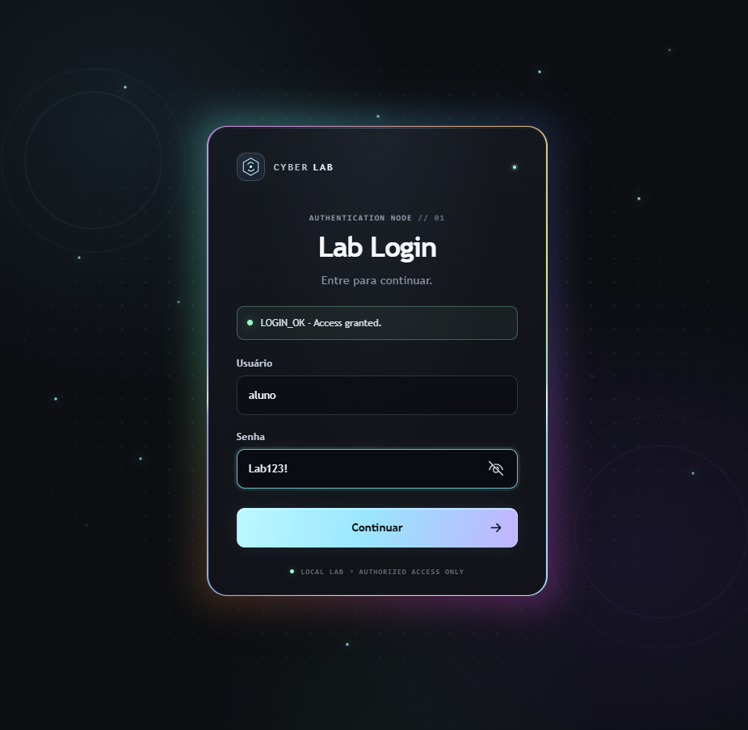
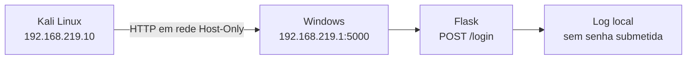
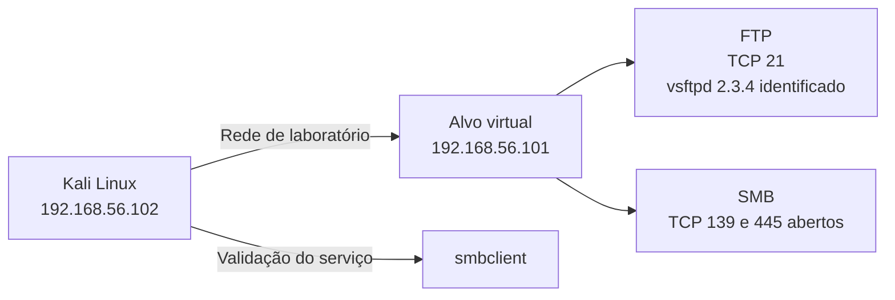

<div align="center">


# Cyber Lab — Vulnerable Login Lab

**Um laboratório educacional para observar autenticação web, FTP e SMB em ambientes isolados.**


[Sobre](#sobre-o-projeto) · [Demonstração](#demonstração) · [Tecnologias](#tecnologias) · [Começando](#começando) · [Atividades](#atividades-do-laboratório) · [Testes](#testes) · [Roadmap](#roadmap)

</div>

> [!CAUTION]
> **Uso exclusivamente educacional e autorizado.** A aplicação Flask deste repositório é intencionalmente vulnerável. Execute-a e realize testes de autenticação apenas em máquinas próprias ou ambientes para os quais você tenha autorização explícita. Não exponha serviços vulneráveis à Internet, não use credenciais pessoais ou reutilizadas e não teste sistemas de terceiros.

> [!NOTE]
> Este é um projeto acadêmico independente desenvolvido por Gabriel Almeida no contexto dos estudos de cibersegurança e de uma atividade da DIO. **Não é uma aplicação oficial da DIO, não possui integração com a plataforma e não representa endosso ou afiliação.**

## Sumário

- [Sobre o projeto](#sobre-o-projeto)
- [Demonstração](#demonstração)
- [Escopo e estado dos cenários](#escopo-e-estado-dos-cenários)
- [Tecnologias](#tecnologias)
- [Arquitetura do laboratório](#arquitetura-do-laboratório)
- [Começando](#começando)
- [Uso da aplicação Flask](#uso-da-aplicação-flask)
- [Atividades do laboratório](#atividades-do-laboratório)
- [Estrutura do projeto](#estrutura-do-projeto)
- [Testes](#testes)
- [Segurança e limitações](#segurança-e-limitações)
- [Roadmap](#roadmap)
- [Documentação complementar](#documentação-complementar)
- [Contribuição e licença](#contribuição-e-licença)
- [Autor](#autor)

---

## Sobre o projeto

O **Cyber Lab — Vulnerable Login Lab** reúne exercícios para compreender como sistemas de autenticação respondem a tentativas de login, como ferramentas de auditoria interagem com serviços de laboratório e como documentar resultados de forma reproduzível.

A parte web utiliza uma aplicação própria em Flask, criada para observar o fluxo entre formulário HTML, requisição HTTP, validação no servidor e logs locais. Para os cenários de serviço, o laboratório registra verificações de conectividade e autenticação nos serviços FTP e SMB de um alvo virtual autorizado.

O desafio da DIO permite adaptar o ambiente à realidade do estudante. Como o DVWA não chegou a funcionar como alvo no ambiente disponível, o cenário web foi adaptado para um formulário Flask próprio. Esta documentação registra essa adaptação e não afirma que o exercício web foi realizado no DVWA.

O objetivo não é criar um sistema de autenticação de produção. É tornar visíveis as limitações de uma implementação vulnerável, praticar a leitura de evidências e comparar essa linha de base com uma versão reforçada.

Para manter a comparação rastreável, a implementação original está em `vulnerable/`. A pasta `hardened/` contém apenas a estrutura inicial e a mesma camada visual: **a implementação defensiva ainda não existe e não deve ser considerada segura nem executável**. As duas versões terão código e testes separados.

## Demonstração

As capturas abaixo foram produzidas durante os exercícios no ambiente local. Elas documentam a interface web, a requisição HTTP observada no navegador, o resultado do teste controlado e os exercícios FTP/SMB; não representam uma demonstração online.

<p align="center">
  
  
  
</p>

**Galerias de evidências:** [Web — Flask e Medusa](images/web/) · [FTP](images/ftp/) · [SMB](images/smb/) · [Preparação e linha de base](images/desenvolvimento/)

## Escopo e estado dos cenários

| Cenário | O que foi feito | Estado registrado | Evidências |
|---|---|---|---|
| Web — Flask autoral | Inspeção pelo DevTools, verificação da resposta de falha, teste controlado com Medusa e validação final no formulário | Exercício realizado no ambiente local; seis capturas registram a interface, conectividade, requisição, execução do Medusa e validação do login | [Evidências web](images/web/) |
| Atividade 1 — FTP | Verificação de conectividade, identificação da porta 21, teste com Medusa e nova conexão FTP para validar a autenticação | O Nmap identificou `21/tcp open ftp vsftpd 2.3.4`; o resultado do Medusa e a conexão FTP posterior foram registrados nas capturas | [Evidências FTP](images/ftp/) |
| Atividade 3 — SMB | Verificação das portas 139/445, enumeração com `enum4linux`, teste com Medusa e validação posterior com `smbclient` | A execução e a validação foram relatadas e registradas nas capturas | [Evidências SMB](images/smb/) |
| Versão `hardened` | Estrutura inicial com HTML/CSS compartilhando a direção visual | Esqueleto criado; ainda sem backend, controles defensivos ou testes próprios | [Estado da estrutura](hardened/README.md) |

Os estados acima descrevem os registros disponíveis. A atualização deste README não significa que todos os testes de rede tenham sido repetidos durante a escrita da documentação. Consulte as capturas para conhecer o resultado efetivamente registrado em cada etapa.

## Tecnologias

<p align="center">
  
</p>

| Tecnologia ou ferramenta | Papel no projeto |
|---|---|
| **Python** | Linguagem da aplicação Flask e dos testes automatizados |
| **Flask 3.0.3** | Servidor web e rotas do formulário demonstrativo |
| **Jinja2, HTML e CSS** | Formulário e apresentação da aplicação web |
| **pytest 8.3.3** | Testes automatizados da versão vulnerável |
| **Kali Linux** | Ambiente de laboratório para as ferramentas de teste |
| **Medusa** | Testes controlados de autenticação nos alvos autorizados |
| **Nmap** | Identificação de portas e serviços acessíveis |
| **enum4linux e smbclient** | Consulta e validação no cenário SMB |
| **Oracle VirtualBox** | Execução das máquinas virtuais e configuração de rede isolada |
| **Git e GitHub** | Versionamento, documentação e compartilhamento do projeto |

As dependências Python declaradas no repositório são Flask e pytest. As ferramentas de rede são instaladas e executadas na VM Kali e podem variar conforme a versão da distribuição.

## Arquitetura do laboratório

Os exercícios web e FTP/SMB foram realizados em configurações de rede diferentes. **Não misture os endereços históricos nem presuma que todos os adaptadores estão ativos simultaneamente.** Confirme os IPs atuais antes de reproduzir cada cenário.

### Cenário web histórico



O diagrama representa os endereços registrados no exercício web anterior. Substitua-os pelos valores atuais caso a rede virtual tenha mudado.

### Cenários FTP e SMB registrados



O endereço `192.168.56.101` foi o alvo utilizado nos registros dos exercícios. A identidade exata da VM que executava esses serviços deve ser conferida no ambiente atual. **Metasploitable 2 é um sistema convidado deliberadamente vulnerável; não é sinônimo do Ubuntu Server que possa hospedar ou executar a máquina virtual.**

## Começando

### Pré-requisitos

- Windows com Python e `pip` para executar o cenário Flask.
- Oracle VirtualBox e Kali Linux para reproduzir os exercícios de rede.
- Medusa, Nmap e, para o cenário SMB, `enum4linux` e `smbclient` disponíveis no Kali.
- Uma rede Host-Only ou Internal Network configurada para o laboratório.
- Máquinas-alvo próprias ou autorização explícita para os testes.

> [!IMPORTANT]
> Os cenários de rede devem permanecer isolados. Não use adaptadores Bridged para expor deliberadamente serviços vulneráveis e confirme IP, serviço e alvo antes de qualquer teste ativo.

### 1. Clonar o repositório

```bash
git clone https://github.com/GabrielJalmeida/cyber.vulnerable-login-lab.git
cd cyber.vulnerable-login-lab
```

### 2. Preparar o ambiente Python no Windows

Abra o CMD na pasta do projeto:

```bat
py -m venv venv
venv\Scripts\activate
python -m pip install -r vulnerable/requirements.txt
```

O arquivo `vulnerable/requirements.txt` fixa as versões Flask `3.0.3` e pytest `8.3.3`.

### 3. Executar a aplicação localmente

Para manter o serviço acessível somente no próprio Windows, execute:

```bat
python vulnerable/app.py
```

Por padrão, a aplicação usa `127.0.0.1` e a porta `5000`. Acesse `http://127.0.0.1:5000` no navegador.

Para reproduzir o exercício histórico a partir do Kali, o servidor precisa escutar no endereço atual do adaptador Host-Only do Windows. No exemplo abaixo, `192.168.219.1` é o IP registrado no exercício antigo — confirme o valor com `ipconfig` antes de usar:

```bat
python vulnerable/app.py --host 192.168.219.1 --port 5000
```

O ponto de entrada `python vulnerable/app.py` recusa `0.0.0.0`. Não contorne essa proteção nem publique a aplicação vulnerável em uma interface pública. Encerre o servidor com <kbd>Ctrl</kbd> + <kbd>C</kbd> ao terminar.

## Uso da aplicação Flask

### Fluxo HTTP

- `GET /` apresenta o formulário de login.
- `POST /login` recebe os campos `username` e `password`.
- A aplicação devolve o marcador `LOGIN_OK` quando a credencial demonstrativa é aceita e `LOGIN_FAILED` quando é rejeitada.
- Na implementação didática, os dois caminhos usam HTTP `200`; a distinção é feita pelo corpo da resposta para facilitar o exercício com o módulo web do Medusa. Isso não é uma recomendação para sistemas de produção.
- O log local `login_attempts.log` registra horário, usuário enviado e resultado, mas não deve registrar a senha submetida. O `.gitignore` exclui arquivos `*.log`.

A conta demonstrativa está definida no código e é exclusiva do laboratório. Nunca reutilize essa credencial em serviços reais.

### Inspecionar uma requisição manual

Com o Flask em execução no próprio Windows, envie uma requisição de teste para o endereço local:

```bash
curl -i -X POST --data-urlencode 'username=aluno' --data-urlencode 'password=Lab123!' http://127.0.0.1:5000/login
```

Para testar a partir do Kali, substitua o endereço local pelo IP Host-Only do Windows confirmado no ambiente. Use apenas a credencial fictícia definida no código do laboratório.

### Observar a requisição no navegador

1. Abra a página de login.
2. Pressione <kbd>F12</kbd> e selecione **Network / Rede**.
3. Envie uma tentativa de login.
4. Inspecione a requisição `POST /login`, os campos do formulário, o status HTTP e o marcador de resposta.

<details>
<summary><strong>Ver reprodução histórica do teste web com Medusa</strong></summary>

O procedimento a seguir descreve o exercício histórico contra o formulário Flask autoral, não contra a plataforma DIO ou qualquer serviço público. Execute somente no laboratório autorizado.

Primeiro, consulte as opções do módulo instalado no Kali:

```bash
medusa -M web-form -q
```

As wordlists públicas do projeto ficam em `wordlists/usernames.txt` e `wordlists/passwords.txt`. Elas são listas curtas de demonstração. O teste histórico usou o endereço Host-Only registrado para o Windows; confirme o IP atual antes da reprodução:

```bash
medusa -h 192.168.219.1 -n 5000 -U wordlists/usernames.txt -P wordlists/passwords.txt -M web-form -m FORM:login -m 'FORM-DATA:POST?username=&password=' -m 'DENY-SIGNAL:LOGIN_FAILED' -t 1
```

Esse comando é um exemplo histórico para o alvo Flask local. A sintaxe e as opções podem variar com a versão instalada; confira a ajuda local do Medusa antes de usar. Não direcione o comando a sites, contas, serviços da faculdade, empresas ou sistemas de terceiros.

O resultado documentado anteriormente indicou a credencial demonstrativa, e o log Flask registrou uma requisição originada do Kali. O exercício não comprova comprometimento do Windows, do Kali ou de outro serviço.

</details>

## Atividades do laboratório

### Cenário web — formulário Flask e Medusa

O cenário web foi realizado contra a aplicação Flask própria, hospedada no Windows e acessada a partir do Kali pela rede Host-Only do laboratório. O exercício incluiu a análise do formulário no navegador, a observação da requisição HTTP, a tentativa controlada com o Medusa e a confirmação final no formulário.

**Resultado e interpretação:**

- O navegador enviou uma requisição `POST` para `/login`.
- A tentativa com credenciais incorretas devolveu o marcador `LOGIN_FAILED` com HTTP `200`. O status `200`, isoladamente, não demonstra autenticação bem-sucedida; o conteúdo da resposta indicou a falha lógica esperada.
- A execução do Medusa reportou a credencial demonstrativa do laboratório como encontrada.
- Uma submissão posterior no próprio formulário retornou `LOGIN_OK`, confirmando o resultado no alvo web.
- O exercício demonstra a fragilidade de um login sem limitação de tentativas; não demonstra comprometimento do Windows nem acesso a outros serviços.

| Evidência | O que documenta |
|---|---|
| [01 — Tela de login](images/web/01-tela-login.png) | Aparência da aplicação antes dos testes |
| [02 — Conectividade Kali](images/web/02-conectividade-kali.png) | Verificação da comunicação e acesso HTTP ao alvo |
| [03 — Análise no F12](images/web/03-analise-requisicao-f12.png) | Método `POST`, status HTTP e resposta `LOGIN_FAILED` observados no navegador |
| [04 — Resultado Medusa](images/web/04-resultado-medusa.png) | Registro da execução do teste controlado |
| [05 — Credencial encontrada](images/web/05-login-encontrado.png) | Saída que identifica a credencial fictícia do laboratório |
| [06 — Login confirmado](images/web/06-validacao-login-sucesso.png) | Confirmação visual de `LOGIN_OK` no formulário |

As capturas representam o que foi registrado durante a sessão do exercício. Endereços IP privados mostrados nas imagens pertencem à configuração de laboratório usada naquele momento; confirme os endereços atuais antes de repetir o cenário.

### Atividade 1 — FTP com Kali Linux e Medusa

**Procedimento registrado:**

1. Confirmar os endereços atuais e a conectividade entre o Kali e o alvo autorizado.
2. Verificar a porta TCP 21 com Nmap.
3. Conectar ao serviço FTP e confirmar que ele responde.
4. Usar listas pequenas e fictícias exclusivas do laboratório.
5. Conferir a ajuda da versão local do Medusa antes do teste controlado.
6. Validar o resultado conectando-se novamente ao serviço FTP.
7. Encerrar a sessão com `quit` e revisar as capturas.

**Resultados registrados:**

- Kali: `192.168.56.102`.
- Alvo de laboratório: `192.168.56.101`.
- O `ping` recebeu respostas.
- O Nmap identificou `21/tcp open ftp vsftpd 2.3.4`.
- O resultado do Medusa e a conexão FTP posterior foram registrados nas capturas da atividade.

A autenticação bem-sucedida comprova acesso ao **serviço FTP com a conta testada**. Não comprova, por si só, acesso a um shell, terminal ou controle administrativo do sistema operacional.

| Evidência | O que documenta |
|---|---|
| [01 — Conectividade e Nmap](images/ftp/01-conectividade-e-nmap.png) | Conectividade e identificação do serviço FTP |
| [02 — Medusa](images/ftp/02-medusa-conectando.png) | Execução e resultado registrado do teste com Medusa |
| [03 — FTP conectado](images/ftp/03-ftp-conectado.png) | Validação posterior da autenticação FTP |

### Atividade 3 — SMB, enumeração e validação com `smbclient`

**Procedimento registrado:**

1. Confirmar o alvo autorizado e verificar as portas TCP 139 e 445.
2. Executar `enum4linux` para consultar informações SMB disponíveis conforme a configuração do serviço.
3. Preparar listas pequenas de usuários e senhas fictícios.
4. Conferir a ajuda local do Medusa e usar o módulo SMB compatível com a versão instalada.
5. Registrar o resultado observado e classificar a técnica conforme a ordem real das tentativas. O uso de `-U` e `-P`, isoladamente, não comprova password spraying.
6. Usar `smbclient` para validar a autenticação e/ou consultar os compartilhamentos permitidos pela conta testada.
7. Revisar e sanitizar as capturas.

**Resultados registrados:**

- Kali: `192.168.56.102`.
- Alvo de laboratório: `192.168.56.101`.
- O Nmap indicou as portas TCP 139 e 445 abertas.
- A enumeração com `enum4linux`, o teste controlado com Medusa e a validação posterior com `smbclient` foram registrados nas evidências da atividade.

Uma resposta positiva do `smbclient` pode confirmar autenticação ou listagem de compartilhamentos no contexto testado. Isso, por si só, **não significa que foi aberta uma sessão de terminal no sistema inteiro**. A conclusão deve corresponder exatamente ao que aparece na captura.

| Evidência | O que documenta |
|---|---|
| [01 — Nmap SMB](images/smb/01-nmap-smb.png) | Identificação das portas SMB |
| [02 — Preparação das listas](images/smb/02-criando-textos.png) | Preparação dos arquivos de texto usados no exercício |
| [03 — Medusa](images/smb/03-medusa-conectado.png) | Execução e resultado registrado do teste com Medusa |
| [04 — Validação com smbclient](images/smb/04-validacao-smbclient.png) | Validação posterior no serviço SMB |

<details>
<summary><strong>Comandos de consulta usados nos cenários FTP e SMB</strong></summary>

Use os endereços atuais confirmados do laboratório; `192.168.56.101` é o endereço histórico registrado neste exercício.

Verificar FTP:

```bash
nmap -Pn -sV -p 21 192.168.56.101
ftp 192.168.56.101
```

Verificar SMB:

```bash
nmap -Pn -sV -p 139,445 192.168.56.101
enum4linux -a 192.168.56.101
```

Consultar compartilhamentos SMB com uma conta fictícia autorizada:

```bash
smbclient -L //192.168.56.101 -U USUARIO_DE_TESTE
```

Esses comandos consultam o serviço e não substituem a análise do resultado. Antes de executar qualquer tentativa de credenciais, confirme o escopo, a versão da ferramenta, o alvo e o uso exclusivo de contas/listas sintéticas.

</details>

## Estrutura do projeto

```text
cyber.vulnerable-login-lab/
├── README.md                         # Visão geral e comandos para as duas versões
├── .gitignore                        # Regras comuns para ambiente, caches e logs
├── vulnerable/                       # Linha de base vulnerável preservada
│   ├── README.md                     # Escopo e execução da versão vulnerável
│   ├── app.py                        # Backend Flask original do laboratório
│   ├── requirements.txt              # Dependências da versão vulnerável
│   ├── templates/login.html          # Interface do login
│   ├── static/style.css              # Efeitos visuais da interface
│   └── tests/test_app.py             # Cinco testes da linha de base
├── hardened/                         # Esqueleto para a futura versão defensiva
│   ├── README.md                     # Estado real e critérios planejados
│   ├── requirements.txt              # Dependências iniciais, ainda mínimas
│   ├── templates/login.html          # Base visual para preservar consistência
│   └── static/style.css              # Mesma direção visual da versão vulnerável
├── docs/
│   ├── assets/banner.svg             # Banner local do README
│   ├── diario-do-laboratorio.md      # Histórico da atividade web
│   ├── guia-de-reproducao.md         # Procedimento de laboratório atualizado
│   └── seguranca-e-limitacoes.md     # Limitações e controles recomendados
├── images/                           # Evidências reais dos exercícios
│   ├── desenvolvimento/
│   ├── web/
│   ├── ftp/
│   └── smb/
└── wordlists/                        # Listas curtas didáticas versionadas
```

`hardened/` é um ponto de partida visual, não uma aplicação pronta. Não a execute nem a descreva como protegida até que o backend e os testes defensivos sejam implementados.

## Testes

Na pasta do projeto, com o ambiente virtual disponível, execute:

```bat
venv\Scripts\python.exe -m pytest -q
```

A suíte existente contém cinco testes para carregamento da página, credenciais válidas, senha inválida, usuário inválido e campos ausentes. Após qualquer alteração em HTML, CSS ou Python, execute os testes novamente no ambiente local. Uma execução anterior passou nos cinco testes, mas esse resultado não substitui a verificação do estado atual do repositório.

## Segurança e limitações

A aplicação Flask é intencionalmente vulnerável e serve apenas como alvo de estudo. Ela não deve ser usada em produção. Na versão original documentada:

- A credencial demonstrativa está definida em código e não deve ser reutilizada em nenhum serviço real.
- Não há limitação de tentativas, bloqueio temporário ou atraso progressivo.
- Não há banco de dados nem autenticação baseada em sessão de produção.
- Não há MFA; a aplicação não implementa CSRF, HTTPS/TLS ou cabeçalhos de segurança de produção.
- HTTP `200` é usado tanto no caminho de sucesso como no de falha para facilitar a leitura do resultado no exercício web. Isso é uma decisão didática, não uma recomendação de contrato HTTP real.
- O log local não deve conter a senha submetida; revise os logs antes de compartilhá-los e mantenha-os fora do Git.
- Os resultados FTP/SMB se limitam aos serviços e às credenciais testados. Não implicam controle do sistema operacional.

Para aplicações reais, considere hashing de senhas com uma biblioteca apropriada (por exemplo, Argon2id, scrypt ou bcrypt), rate limiting com recuperação segura, MFA quando aplicável, sessões e cookies seguros, proteção CSRF, HTTPS, logs sem segredos, tratamento de erros e testes de regressão.

> [!WARNING]
> A identificação `vsftpd 2.3.4` merece cautela: a [CVE-2011-2523](https://nvd.nist.gov/vuln/detail/CVE-2011-2523) descreve uma backdoor em um pacote distribuído em uma janela específica (downloads entre 30/06 e 03/07/2011). O banner identificado pelo Nmap, isoladamente, não comprova que o binário do alvo contém essa backdoor. Essa questão é distinta do exercício de brute force. O escopo deste trabalho é observar autenticação nos serviços de laboratório; não é necessário investigar nem explorar a backdoor para concluir as atividades documentadas.

## Roadmap

- [x] Preservar a implementação Flask vulnerável e registrar sua linha de base de cinco testes.
- [x] Documentar a adaptação do cenário web porque o DVWA não pôde ser executado neste ambiente.
- [x] Registrar evidências dos exercícios web, FTP e SMB, incluindo a validação SMB com `smbclient`.
- [x] Melhorar a apresentação visual do formulário vulnerável sem alterar a rota nem os nomes dos campos utilizados no exercício.
- [x] Preparar regras do `.gitignore` para listas temporárias de laboratório.
- [ ] Revisar e alinhar os guias complementares com o código e o ambiente documentado.
- [ ] Implementar a aplicação `hardened` em diretório separado, sem alterar a linha de base vulnerável.
- [ ] Criar testes para limitação e recuperação de tentativas, logs sem segredos, sessão e demais controles adotados.
- [ ] Comparar as versões vulnerável e reforçada com evidências reproduzíveis.
- [ ] Revisar dependências, segredos, capturas e diff antes da publicação final.

## Documentação complementar

- [Diário do laboratório](docs/diario-do-laboratorio.md) — problemas encontrados, hipóteses e correções durante o exercício Flask.
- [Guia de reprodução](docs/guia-de-reproducao.md) — etapas históricas de configuração e teste web; confira os comandos antes de executá-los, pois algumas anotações antigas podem não corresponder ao código atual.
- [Segurança e limitações](docs/seguranca-e-limitacoes.md) — fraquezas intencionais, riscos e controles recomendados.

## Contribuição e licença

Este projeto é uma atividade acadêmica em evolução. Sugestões podem ser registradas por meio de issues, desde que não incluam credenciais reais, tokens, cookies, dados pessoais ou logs brutos desnecessários.

**Licença:** não há um arquivo `LICENSE` identificado na estrutura atual do repositório. Até que uma licença seja adicionada, não presuma que a publicação do código concede autorização geral para reutilização ou redistribuição.

## Autor

**Gabriel Almeida** — [@GabrielJalmeida no GitHub](https://github.com/GabrielJalmeida)

Este laboratório foi desenvolvido para fins educacionais, com escopo controlado e registro explícito do que foi observado, do que foi adaptado e do que permanece planejado.
