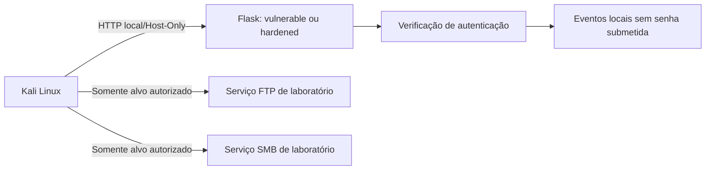

<div align="center">


# Cyber Lab — Vulnerable Login Lab

**Laboratório educacional de autenticação web, análise de evidências e controles defensivos.**


[Visão geral](#visão-geral) · [Demonstração](#demonstração) · [Começar](#começar) · [Versões](#as-duas-versões) · [Evidências](#atividades-e-evidências) · [Testes](#testes) · [Limitações](#segurança-e-limitações)

</div>

> [!CAUTION]
> **Uso exclusivamente educacional e autorizado.** A pasta `vulnerable/` contém uma aplicação intencionalmente vulnerável e não deve ser exposta à Internet. Execute testes ativos somente em máquinas próprias ou alvos com autorização explícita. Use contas e listas sintéticas; nunca reutilize credenciais pessoais, acadêmicas ou profissionais.

> [!NOTE]
> Projeto acadêmico independente de Gabriel Almeida, desenvolvido no contexto de estudos de cibersegurança e de uma atividade da DIO. **Não é um sistema oficial da DIO, não possui integração com a plataforma e não representa endosso ou afiliação.**

## Sumário

- [Visão geral](#visão-geral)
- [Demonstração](#demonstração)
- [As duas versões](#as-duas-versões)
- [Tecnologias](#tecnologias)
- [Começar](#começar)
- [Atividades e evidências](#atividades-e-evidências)
- [Arquitetura e ambiente](#arquitetura-e-ambiente)
- [Testes](#testes)
- [Estrutura do projeto](#estrutura-do-projeto)
- [Segurança e limitações](#segurança-e-limitações)
- [Documentação complementar](#documentação-complementar)
- [Roadmap](#roadmap)
- [Licença e autor](#licença-e-autor)

---

## Visão geral

O **Cyber Lab — Vulnerable Login Lab** reúne exercícios para compreender respostas de autenticação, tentativas repetidas de login, análise de requisições HTTP e documentação de resultados reproduzíveis. Também registra exercícios de conectividade e autenticação em serviços FTP e SMB de um ambiente virtual autorizado.

O cenário web foi adaptado para uma aplicação Flask própria porque o DVWA não funcionou no ambiente utilizado. Portanto, os registros web deste projeto são de um **formulário Flask autoral**, não de uma execução do DVWA.

O repositório mantém duas aplicações separadas: uma linha de base didática vulnerável e uma versão `hardened` com controles defensivos testáveis. Elas têm dependências, configurações e testes independentes.

## Demonstração

As imagens abaixo são capturas históricas dos exercícios realizados localmente; não são demonstrações online nem capturas da nova interface `hardened`.

<p align="center">
  
  
  
</p>

**Galerias de evidências:** [Web — Flask e Medusa](images/web/) · [FTP](images/ftp/) · [SMB](images/smb/) · [Desenvolvimento e linha de base](images/desenvolvimento/)

## As duas versões

| Versão | Objetivo | Estado e comportamento |
|---|---|---|
| [`vulnerable/`](vulnerable/) | Linha de base para exercícios autorizados de autenticação | Flask 3.0.3; não limita tentativas. Mantém os marcadores didáticos `LOGIN_OK`/`LOGIN_FAILED` e usa HTTP `200` para ambos os resultados. **Não é segura e não deve ser exposta à Internet.** |
| [`hardened/`](hardened/) | Comparar uma implementação com controles defensivos | Flask 3.1.3; Argon2id, CSRF, sessão temporária, headers defensivos, limites de entrada e rate limiting em memória. Interface tech/gamer neon com formulário em formato de cadeado. |

### Controles implementados em `hardened/`

- **Senhas:** hash Argon2id (`m=19456 KiB`, `t=2`, `p=1`) por `argon2-cffi`.
- **Tentativas repetidas:** até cinco submissões por IP em uma janela de 60 segundos; a partir da sexta tentativa, a aplicação retorna `429` e bloqueia por 60 segundos.
- **Formulários:** proteção CSRF no login e logout.
- **Sessão:** cookie assinado, `HttpOnly`, `SameSite=Lax` e expiração de 15 minutos. `Secure` fica desativado para o laboratório local em HTTP.
- **Respostas e navegador:** tratamento controlado de configuração inválida, headers defensivos, limite de tamanho de requisição/campos e `Cache-Control: no-store`.
- **Configuração:** `setup_lab.py` gera o hash e uma chave de sessão aleatória, gravando a configuração local em `.env`.

Esses controles reduzem riscos nos cenários cobertos, mas **não tornam a aplicação invulnerável nem pronta para produção**. Consulte [`hardened/README.md`](hardened/README.md) para política, execução e limitações.

## Tecnologias

<p align="center">
  
</p>

| Tecnologia/ferramenta | Uso |
|---|---|
| Python, Flask, Jinja2, HTML e CSS | Aplicações web e interfaces do laboratório |
| pytest | Testes automatizados separados por versão |
| Flask-WTF | Proteção CSRF na versão `hardened` |
| argon2-cffi | Hash de senha Argon2id na versão `hardened` |
| python-dotenv | Leitura de configuração local por `.env` na versão `hardened` |
| Kali Linux e Medusa | Exercícios controlados de autenticação em alvos próprios/autorizados |
| Nmap | Identificação de portas e serviços no ambiente isolado |
| enum4linux e smbclient | Consulta e validação no cenário SMB |
| Oracle VirtualBox | Máquinas virtuais e redes isoladas de laboratório |
| Git e GitHub | Versionamento e documentação |

As dependências Python são separadas: `vulnerable/requirements.txt` atende à linha de base; `hardened/requirements.txt` atende à implementação com controles defensivos.

## Começar

### Pré-requisitos

- Python 3.10 ou superior (a versão efetivamente instalada e as dependências resolvidas podem variar por ambiente).
- Windows, CMD/PowerShell ou terminal compatível.
- Para reproduzir os exercícios de rede: VirtualBox, Kali Linux, ferramentas necessárias e uma rede Host-Only/Internal Network devidamente configurada.
- Máquinas próprias e autorização explícita para qualquer teste ativo.

> [!IMPORTANT]
> Os endereços IP documentados nas evidências são históricos, não configurações atuais garantidas. Antes de executar exercícios de rede, confirme a identidade do alvo, o endereço, a porta, os adaptadores virtuais e o escopo. Não use Bridged Adapter para expor deliberadamente serviços vulneráveis.

### 1. Clonar o repositório

```bash
git clone https://github.com/GabrielJalmeida/cyber.vulnerable-login-lab.git
cd cyber.vulnerable-login-lab
```

### 2. Executar a versão `hardened` (recomendada para a demonstração final)

No Windows, no CMD ou PowerShell:

```bat
cd hardened
py -m venv .venv
.venv\Scripts\python.exe -m pip install -r requirements.txt
.venv\Scripts\python.exe setup_lab.py
.venv\Scripts\python.exe -m pytest -q
.venv\Scripts\python.exe run.py
```

O assistente `setup_lab.py` solicitará um nome de usuário de demonstração e uma senha exclusiva do laboratório, pedirá confirmação e gerará um hash Argon2id e uma chave de sessão aleatória em `.env`. A senha em texto claro não é gravada. O script não sobrescreve um `.env` existente.

Abra `http://127.0.0.1:5001`. O servidor faz bind somente em `127.0.0.1`, com `debug=False`. Não publique nem exponha essa aplicação à Internet como se fosse um sistema de autenticação pronto para produção.

**Proteja o arquivo `hardened/.env`: nunca o versione nem compartilhe.** O modelo seguro de configuração é [`hardened/.env.example`](hardened/.env.example); seus placeholders não são credenciais utilizáveis.

### 3. Executar a versão `vulnerable` (somente para o exercício isolado)

A partir da raiz do repositório, crie um ambiente separado e instale apenas as dependências desta versão:

```bat
py -m venv venv
venv\Scripts\python.exe -m pip install -r vulnerable\requirements.txt
venv\Scripts\python.exe -m pytest -q vulnerable\tests
venv\Scripts\python.exe vulnerable\app.py
```

Por padrão, a aplicação usa `127.0.0.1:5000`. Acesse `http://127.0.0.1:5000`. O cenário web histórico a partir do Kali usou uma rede Host-Only; caso reproduza esse exercício, confirme o IP privado atual e consulte [`vulnerable/README.md`](vulnerable/README.md). Não use `0.0.0.0` ou uma interface pública.

A versão `vulnerable` não tem rate limiting e retorna HTTP `200` tanto para sucesso quanto para falha, distinguindo os resultados pelo corpo da resposta. Isso faz parte da demonstração didática, não é uma recomendação para aplicações reais.

## Atividades e evidências

Os exercícios foram registrados nas capturas existentes nas pastas `images/`. A tabela resume o escopo e não afirma que os testes de rede foram repetidos durante a última atualização da documentação.

| Cenário | Atividade registrada | Evidências |
|---|---|---|
| Web — Flask autoral | Inspeção no DevTools, requisição `POST /login`, teste controlado com Medusa e validação pelo formulário. O DVWA não foi executado neste ambiente. | [Galeria web](images/web/) |
| Atividade 1 — FTP | Conectividade, identificação de `21/tcp`, teste com Medusa e validação posterior de autenticação no serviço FTP. | [Galeria FTP](images/ftp/) |
| Atividade 3 — SMB | Portas 139/445, enumeração com `enum4linux`, teste controlado e validação com `smbclient`. | [Galeria SMB](images/smb/) |
| Versão hardened | Autenticação local com controles de segurança, testes automatizados e interface neon de cadeado. | [Código e testes](hardened/) |

As capturas representam somente o resultado visível no momento em que foram produzidas. Uma autenticação bem-sucedida em FTP/SMB demonstra acesso ao serviço com a conta testada; não prova, por si só, execução de shell ou controle administrativo do sistema operacional. O uso das opções `-U` e `-P` não comprova password spraying sem examinar a ordem efetiva das tentativas.

Para procedimentos complementares, consulte [`docs/guia-de-reproducao.md`](docs/guia-de-reproducao.md) e [`docs/diario-do-laboratorio.md`](docs/diario-do-laboratorio.md). Confira as instruções e os endereços antes de reproduzir registros históricos.

## Arquitetura e ambiente

Os cenários web, FTP e SMB foram conduzidos em redes virtuais distintas. Não presuma que os endereços históricos estão ativos simultaneamente:



Os endereços registrados anteriormente incluíram `192.168.219.1`/`192.168.219.10` no cenário web e `192.168.56.101`/`192.168.56.102` nos cenários FTP/SMB. Esses valores são referências históricas; valide IPs, serviços e adaptadores na configuração atual antes de usar qualquer comando. A identificação de `vsftpd 2.3.4` pelo banner, isoladamente, não comprova que o binário contém a backdoor associada à CVE-2011-2523; veja a [referência NVD](https://nvd.nist.gov/vuln/detail/CVE-2011-2523).

## Testes

Execute as suítes separadamente para evitar misturar dependências e objetivos das duas aplicações.

**Linha de base vulnerável** — a suíte existente cobre carregamento da página, credenciais válidas/inválidas, usuário inválido e campos ausentes:

```bat
venv\Scripts\python.exe -m pytest -q vulnerable\tests
```

**Versão hardened** — dentro de `hardened/`, com suas dependências instaladas:

```bat
.venv\Scripts\python.exe -m pytest -q
```

**Últimos resultados locais informados durante o desenvolvimento (26/10/2026):** a suíte `hardened` passou com `15 passed in 0.65s` no Windows usando Python 3.14.6. A linha de base `vulnerable` teve uma execução registrada anteriormente com cinco testes passando. Esses são registros de execução local, não resultados de CI nem garantia para todos os sistemas.

A suíte `hardened` inclui cenários para autenticação, configuração/hash inválido, CSRF, sessão, rate limiting, recuperação e headers. O teste do rate limit usa relógio controlado para não depender de espera real de 60 segundos.

## Estrutura do projeto

```text
cyber.vulnerable-login-lab/
├── README.md
├── .gitignore
├── vulnerable/                       # Linha de base Flask intencionalmente vulnerável
│   ├── README.md
│   ├── app.py
│   ├── requirements.txt
│   ├── templates/login.html
│   ├── static/style.css
│   └── tests/test_app.py
├── hardened/                         # Aplicação local com controles defensivos
│   ├── README.md
│   ├── .env.example                  # Apenas placeholders, sem segredos reais
│   ├── .gitignore
│   ├── requirements.txt
│   ├── run.py
│   ├── setup_lab.py
│   ├── benchmark_hash.py
│   ├── app/
│   │   ├── routes/auth.py
│   │   ├── security/passwords.py
│   │   ├── security/rate_limit.py
│   │   ├── static/css/
│   │   └── templates/
│   └── tests/
├── docs/
│   ├── assets/banner.jpg
│   ├── diario-do-laboratorio.md
│   ├── guia-de-reproducao.md
│   └── seguranca-e-limitacoes.md
├── images/
│   ├── desenvolvimento/
│   ├── web/
│   ├── ftp/
│   └── smb/
└── wordlists/                        # Listas curtas para fins didáticos
```

## Segurança e limitações

- `vulnerable/` é deliberadamente frágil e serve somente como alvo de estudo isolado.
- `hardened/` é um laboratório didático, não uma aplicação auditada, certificada ou pronta para produção.
- O rate limiter fica em memória, é por IP, perde estado ao reiniciar e não coordena múltiplos processos/workers. Usuários atrás do mesmo IP compartilham o limite; origens diferentes não compartilham o contador.
- A sessão é assinada no cookie do Flask, sem armazenamento de sessão no servidor; um cookie roubado não pode ser revogado individualmente antes de expirar. A expiração curta reduz, mas não elimina, esse risco.
- O servidor local usa HTTP; o cookie `Secure` está desativado nesse modo. HTTPS real é necessário para ativá-lo em uma implantação protegida.
- Não há MFA, persistência de contas, recuperação de senha, monitoramento centralizado ou proteção distribuída contra abuso.
- Headers, CSRF, hash Argon2id e testes são camadas de defesa; sua presença não prova ausência de vulnerabilidades.
- Nunca versione `.env`, credenciais reais, cookies, tokens, logs brutos ou listas temporárias. Revogue/rotacione qualquer segredo real exposto e avalie o histórico Git.
- Não há autorização para testar serviços de terceiros. Timeout, conexão recusada ou banner de versão não provam, sozinhos, bloqueio ou vulnerabilidade específica.

Referências principais: [OWASP Password Storage Cheat Sheet](https://cheatsheetseries.owasp.org/cheatsheets/Password_Storage_Cheat_Sheet.html) · [OWASP Web Security Testing Guide](https://owasp.org/www-project-web-security-testing-guide/) · [NIST SSDF](https://csrc.nist.gov/pubs/sp/800/218/final).

## Documentação complementar

- [`vulnerable/README.md`](vulnerable/README.md) — execução e limitações da linha de base vulnerável.
- [`hardened/README.md`](hardened/README.md) — configuração, execução, rate limit, hashing e limitações da versão reforçada.
- [`docs/diario-do-laboratorio.md`](docs/diario-do-laboratorio.md) — histórico do desenvolvimento e do exercício web.
- [`docs/guia-de-reproducao.md`](docs/guia-de-reproducao.md) — passos históricos para reproduzir o laboratório.
- [`docs/seguranca-e-limitacoes.md`](docs/seguranca-e-limitacoes.md) — riscos, controles e limites documentados.

## Roadmap

- [x] Preservar a linha de base vulnerável e seus testes.
- [x] Documentar a adaptação do cenário web para Flask autoral.
- [x] Registrar evidências dos exercícios web, FTP e SMB.
- [x] Implementar a versão `hardened` separada, com Argon2id, CSRF, sessão, headers e rate limiting.
- [x] Criar testes automatizados para os principais controles implementados.
- [x] Atualizar a interface `hardened` para o tema tech/gamer neon com cadeado.
- [ ] Reunir uma comparação final vulnerável vs. hardened com retestes padronizados e risco residual.
- [ ] Rever e alinhar todos os guias complementares com o estado final do código.
- [ ] Adicionar CI e auditoria de dependências/segredos quando apropriado.

## Licença e autor

Este projeto é uma atividade acadêmica independente. Não foi identificado um arquivo `LICENSE` no repositório; até que uma licença seja adicionada, não presuma que a publicação concede autorização geral de reutilização ou redistribuição.

**Gabriel Almeida** — [@GabrielJalmeida no GitHub](https://github.com/GabrielJalmeida)

Desenvolvido para fins educacionais, com foco em escopo autorizado, evidências reproduzíveis e descrição honesta do que foi implementado e testado.
